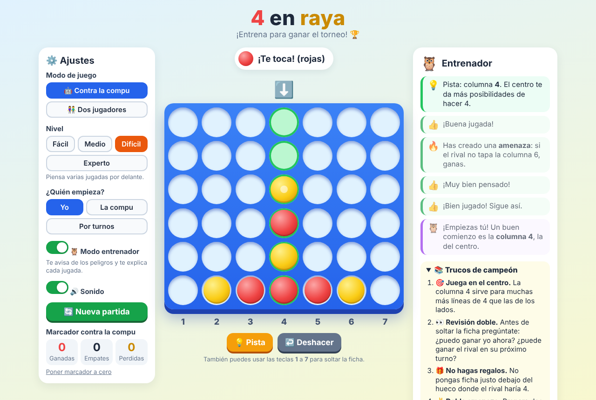
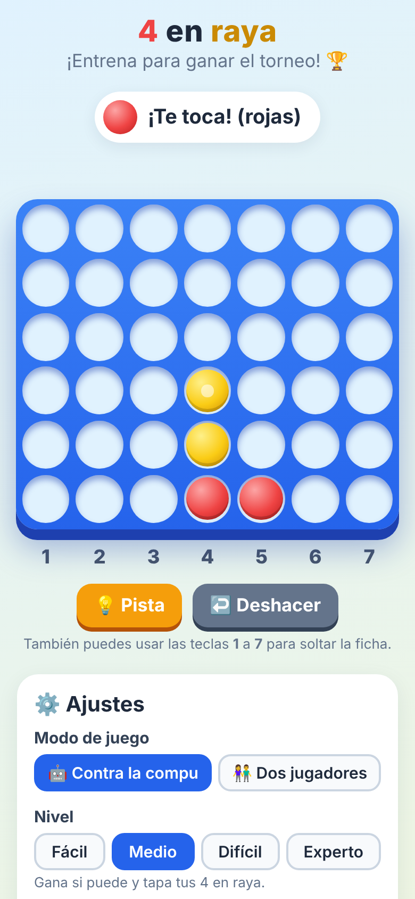

# 🔴 4 en raya 🟡

**Un juego de 4 en raya para aprender y entrenar, con un entrenador que te explica cada jugada.**

### [▶️ Jugar ahora](https://maroke.github.io/4-en-raya/)

---

## ✨ Qué tiene

- 🤖 **Contra la computadora**, con 4 niveles:
  | Nivel | Cómo juega |
  |---|---|
  | 🟢 **Fácil** | Para calentar: a veces se despista. |
  | 🔵 **Medio** | Gana si puede y tapa tus 4 en raya. |
  | 🟠 **Difícil** | Piensa varias jugadas por delante. |
  | 🟣 **Experto** | ¡Nivel torneo! Muy difícil de ganar. |
- 👫 **Dos jugadores** en el mismo ordenador, tablet o móvil.
- 🦉 **Modo entrenador**:
  - **Antes de tu jugada** te avisa si puedes ganar o si el rival te amenaza, pero no te dice dónde: ¡tienes que encontrarlo tú!
  - **Después de tu jugada** te explica qué ha pasado: si se te escapó una victoria, si no tapaste al rival, si le dejaste el hueco para ganar, si creaste una doble amenaza o qué columna era mejor.
- 💡 **Pista**: te marca la mejor columna y te explica por qué.
- ↩️ **Deshacer**: vuelve atrás para repasar los errores.
- 📚 **Trucos de campeón**: los consejos más útiles para ganar más partidas.
- 🏆 Marcador, sonidos y confeti cuando ganas.

## 🎮 Cómo se juega

Por turnos, cada jugador suelta una ficha en una de las 7 columnas. La ficha cae hasta el hueco libre más bajo. **Gana quien consigue 4 fichas seguidas** en horizontal, vertical o diagonal. Si se llena el tablero sin que nadie lo consiga, hay empate.

Para soltar una ficha, haz clic o toca la columna, o pulsa las teclas **1** a **7**. Con **Ctrl + Z** deshaces la última jugada.

## 📚 Trucos de campeón

1. 🎯 **Juega en el centro.** La columna 4 sirve para muchas más líneas de 4 que las de los lados.
2. 👀 **Revisión doble.** Antes de soltar la ficha, pregúntate: ¿puedo ganar yo ahora? ¿Puede ganar el rival en su próximo turno?
3. 🎁 **No hagas regalos.** No pongas ficha justo debajo del hueco donde el rival haría 4.
4. ✌️ **Doble amenaza.** Prepara dos sitios para ganar a la vez: el rival solo puede tapar uno.
5. ↗️ **Ojo a las diagonales.** Son las líneas que más cuesta ver.
6. 🔢 **Truco secreto.** Si empiezas tú, tus amenazas valen más en las filas 1, 3 y 5 (contando desde abajo). Si empieza el rival, en las filas 2, 4 y 6.
7. 🐢 **Sin prisa.** Una ficha no se puede quitar: piensa antes de soltarla.

## 💻 Jugar sin internet

Todo el juego está en un solo archivo, [`index.html`](index.html). Descárgalo y ábrelo con doble clic: funciona en Edge, Chrome, Firefox o Safari, en Windows, Mac, Linux, tablets y móviles. No hace falta instalar nada.

## 🛠️ Cómo está hecho

- HTML, CSS y JavaScript, sin librerías ni dependencias.
- La computadora piensa con el algoritmo **minimax con poda alfa-beta**: imagina las jugadas posibles de los dos jugadores, varias jugadas hacia delante, y elige la mejor. El nivel Experto mira hasta 8 jugadas por delante.
- El marcador se guarda en el navegador de cada persona (`localStorage`).
- El entrenador usa el mismo algoritmo para comparar tu jugada con la mejor posible.

## 📄 Licencia

Este proyecto se publica con la [licencia MIT](LICENSE): puedes usarlo, copiarlo y modificarlo libremente, manteniendo el aviso de licencia.

El 4 en raya es un juego tradicional. Este proyecto es independiente y no está asociado a ningún fabricante de juegos de mesa.

---

Hecho con ❤️ para entrenar antes del torneo del cole.

